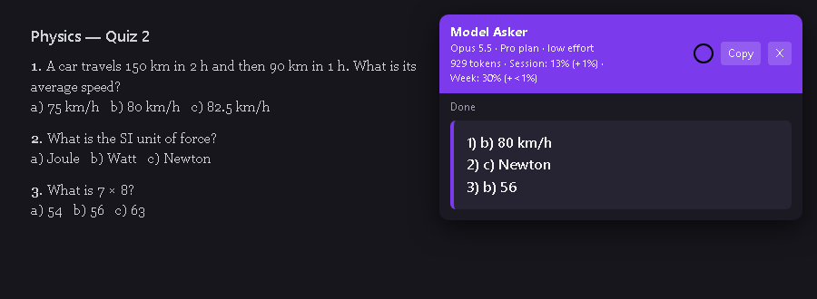
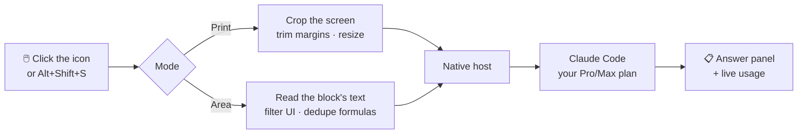
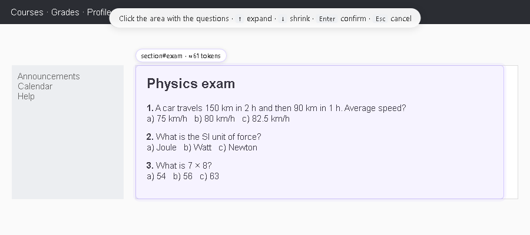
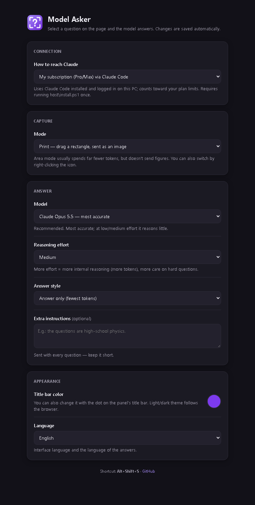
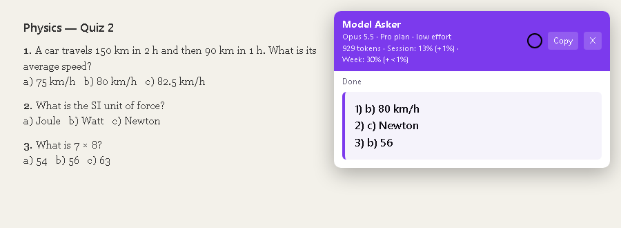

<div align="center">


# Model Asker

**Select a question on any web page — an AI model answers it right there.**

Browser extension for Chrome, Edge and Brave that uses your **Claude Pro/Max subscription** (via Claude Code) or an API key.

[](../../releases/latest)
[](../../releases)
[](../../stargazers)
[](../../commits/main)
[](.)
<br>


**English** · [Português](README.pt-BR.md)



</div>

---

## ✨ Highlights

| | |
|---|---|
| 🖼️ **Print mode** | Drag a rectangle; the crop is sent as an image — great for figures and formulas. |
| 🧩 **Area mode** | Click a block of the page; only its **text** is sent — no HTML, no menus, no buttons. Far cheaper. |
| 💳 **Uses your subscription** | Goes through Claude Code logged into your Pro/Max plan. No API key needed (but supported). |
| 📊 **Real usage, live** | The panel shows model, plan, effort, tokens and **how much each question took from your limit**. |
| 🌍 **3 languages** | Interface and answers in English, Português or Español — or follow the browser. |
| 🌗 **Light / dark** | Panel, selection and settings follow the browser theme, in a clean purple palette. |

## 📉 Numbers at a glance

Measured while building the project (real questions for cost; test pages for the filters):

| What | Result |
|---|---|
| Prompt cache turned off (nothing was ever reused; writes cost 2×) | **−47%** cost per question |
| Formula cleanup on a Moodle exam (MathJax sent once, not symbol-by-symbol) | **−58%** text · **−36%** cost |
| Interface items filtered in area mode ("Next", timers, progress bars…) | up to **−45%** text |
| Empty margins trimmed from print crops | up to **−91%** pixels |
| Haiku vs. Opus on the same exam (same answers) | **~30×** cheaper |

## 🔄 How it works



<div align="center">

<br><sub>Area mode — the block under the mouse is highlighted with a token estimate before sending.</sub>
</div>

---

## 🚀 Quick start

> **Requirements:** Windows 10/11 · [Node.js](https://nodejs.org) 18+ · [Claude Code](https://claude.com/claude-code) logged in (`claude` once in a terminal) · Chrome, Edge or Brave.
> Using only an API key? Claude Code and step 2 are optional.

1. **Download** `model-asker-vX.Y.Z.zip` from [**Releases**](../../releases/latest) and extract it to a permanent folder.
2. **Install the host** — open PowerShell in that folder and run:
   ```powershell
   powershell -ExecutionPolicy Bypass -File host\install.ps1
   ```
3. **Load the extension** — `chrome://extensions` → enable **Developer mode** → **Load unpacked** → pick the `extension` folder.
4. **Restart the browser**, open any page and press **Alt+Shift+S**.

| Mode | How to use |
|---|---|
| **Print** | Drag a rectangle over the question. |
| **Area** | Hover — the block is highlighted — then click. **↑** expand to parent · **↓** back · **Enter** confirm. |
| Both | **Esc** cancels. Switch modes by right-clicking the extension icon. |

<details>
<summary><b>⚙️ Settings</b></summary>

<br>



| Option | What it does |
|---|---|
| How to reach Claude | **Subscription** (via Claude Code, default) or **API key** (pay per use) |
| Mode | Print or HTML area |
| Area highlight color | Only shown in area mode; changes live |
| Model | Opus 5.5 (default), Sonnet 5.5 or Haiku 5.5 |
| Reasoning effort | More effort = more care and more tokens |
| Answer style | **Answer only** (default), + one-line justification, or key steps |
| Title bar color | Also via the dot on the panel; changes live |
| Language | Automatic, English, Português or Español — interface **and** answers |

Everything saves automatically.

<br clear="right">
</details>

<details>
<summary><b>📊 What the panel shows</b></summary>

<br>

```
Opus 5.5 · Pro plan · low effort
929 tokens · Session: 13% (+1%) · Week: 30% (+<1%)
```

- **tokens** — what this question used (input + answer + internal reasoning).
- **Session / Week** — your real account usage (same as Claude Code's `/usage`), read right after the answer.
- **(+N%)** — how much **this question** took, compared with the usage measured when you started selecting. Usage comes in whole percents, so anything under 1% shows as `+<1%`.
- Hover the line for the breakdown and when each limit resets.

<div align="center"></div>
</details>

<details>
<summary><b>💡 Saving tokens</b></summary>

<br>

What the tool already does on its own:

- **Area mode** sends text only and drops interface items inside the area (buttons like "Next"/"Submit", timers, progress bars, navigation, icon names) — conservatively: answer options are never removed, and if the filter would drop more than half the text, the whole area is sent.
- **Formulas** rendered by MathJax (common on Moodle) are sent once instead of whole + one symbol per line, and full-line platform labels ("Answer saved", "Flag question"…) are removed — in Portuguese, English and Spanish.
- **Print mode** trims empty margins, downsizes on zoomed screens (≤30%, still sharp) and caps images at ~0.8 MP.
- **Prompt cache is off**: every question is different and the fixed part is too small to cache, so nothing was reused — and 1-hour cache writes cost double.
- Claude Code's helper calls (session title, context attachments) are turned off.

Choosing a model: **Opus · low** is a great default. **Haiku** gave the same answers on objective questions at ~1/30 of the cost, but reasons more and may slip on hard ones. What matters for your limit is the **(+N%)**, not the raw token count.
</details>

<details>
<summary><b>🔒 Privacy</b></summary>

<br>

- The selected content is sent to Anthropic (through Claude Code or the API) — avoid capturing sensitive data.
- An API key, if used, stays only in the extension's local storage in your browser.
- The host runs Claude Code in an empty temp folder, with no tools, no plugins and no access to your files.
- Personal use: don't share your subscription with other people through the tool.
</details>

<details>
<summary><b>⚠️ Limitations</b></summary>

<br>

- Windows only (the host uses PowerShell and the registry). The extension itself runs on any Chromium browser.
- Doesn't work on internal pages (`chrome://`, Web Store, built-in PDF viewer) — the icon shows a red "!".
- Print mode captures only the visible part of the tab.
- Area mode doesn't send images/figures (the panel tells you) and can't select inside iframes.
</details>

<details>
<summary><b>🛠️ For developers</b></summary>

<br>

```
src/background.js     service worker (bundled with the Anthropic SDK by esbuild)
extension/            static extension files (content script, options, i18n, manifest, icons)
host/                 Native Messaging host + installer
config/defaults.json  public defaults
config/dev.json       YOUR defaults (git-ignored) — copy from config/dev.example.json
build.mjs             builds dist/public, dist/dev and the release zip
```

```bash
npm install
npm run build        # dist/public — neutral defaults (what gets published)
npm run build:dev    # dist/dev    — defaults + config/dev.json; named "Model Asker (dev)"
npm run watch:dev    # rebuild dev on every change
npm run release      # release/model-asker-v<version>.zip (public build + host)
```

Load `dist/dev` in the browser while developing. The dev build writes a **log of every question** (subscription mode) to `logs/`: `resumo.txt` (one line per question: mode, model, tokens, cost, extraction, usage before/after, time) and `requests.jsonl` (instructions, content sent, arguments, Claude Code events, detailed usage). Sent images are saved next to it. The public build logs nothing.

**Translations** live in [`extension/i18n.js`](extension/i18n.js) — add a language by adding a block of strings there.

The `key` field in `manifest.json` pins the extension ID (`obkgoanblboakpomlknmomclngpaicnn`); the host only accepts that ID.

The study plan used to build the project (in Portuguese) is in [PLANO_DE_ESTUDO.md](PLANO_DE_ESTUDO.md).
</details>

---

<div align="center">

<a href="https://star-history.com/#al4sk4s/Model-Asker&Date">
  
</a>

<sub>Made with Claude · Not affiliated with Anthropic</sub>

</div>
