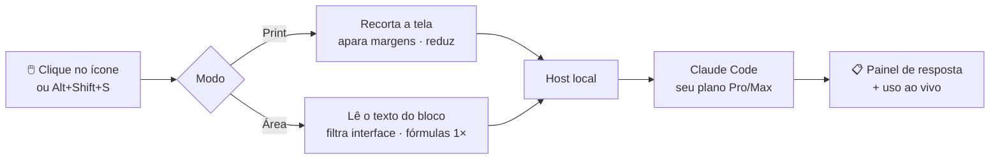

<div align="center">


# Model Asker

**Selecione uma questão em qualquer página — um modelo de IA responde ali mesmo.**

Extensão para Chrome, Edge e Brave que usa a sua **assinatura Claude Pro/Max** (via Claude Code) ou uma chave de API.

[](../../releases/latest)
[](../../releases)
[](../../stargazers)
[](../../commits/main)
[](.)
<br>


[English](README.md) · **Português**


</div>

---

## ✨ Destaques

| | |
|---|---|
| 🖼️ **Modo print** | Arraste um retângulo; o recorte vai como imagem — ótimo para figuras e fórmulas. |
| 🧩 **Modo área** | Clique num bloco da página; só o **texto** dele é enviado — sem HTML, menus ou botões. Bem mais barato. |
| 💳 **Usa sua assinatura** | Passa pelo Claude Code logado no seu plano Pro/Max. Não precisa de chave de API (mas aceita). |
| 📊 **Uso real, ao vivo** | O painel mostra modelo, plano, esforço, tokens e **quanto cada pergunta debitou do seu limite**. |
| 🌍 **3 idiomas** | Interface e respostas em English, Português ou Español — ou seguindo o navegador. |
| 🌗 **Claro / escuro** | Painel, seleção e configurações seguem o tema do navegador, numa paleta roxa limpa. |

## 📉 Números em resumo

Medidos durante o desenvolvimento (questões reais para custo; páginas de teste para os filtros):

| O quê | Resultado |
|---|---|
| Cache de prompt desligado (nada era reaproveitado; gravar custa 2×) | **−47%** de custo por pergunta |
| Limpeza de fórmulas numa prova do Moodle (MathJax enviado uma vez, não símbolo a símbolo) | **−58%** de texto · **−36%** de custo |
| Itens de interface filtrados no modo área ("Próxima", cronômetro, progresso…) | até **−45%** de texto |
| Margens vazias aparadas no modo print | até **−91%** de pixels |
| Haiku vs. Opus na mesma prova (mesmas respostas) | **~30×** mais barato |

## 🔄 Como funciona



<div align="center">

<br><sub>Modo área — o bloco sob o mouse fica destacado, com a estimativa de tokens antes de enviar.</sub>
</div>

---

## 🚀 Começando

> **Pré-requisitos:** Windows 10/11 ou Linux · [Node.js](https://nodejs.org) 18+ · [Claude Code](https://claude.com/claude-code) logado (rode `claude` uma vez no terminal) · Chrome, Chromium, Edge, Brave ou Vivaldi.
> Vai usar só chave de API? O Claude Code e a instalação do host são opcionais.

<table>
<tr><th width="50%">🪟 Windows</th><th width="50%">🐧 Linux (Arch e outros)</th></tr>
<tr><td valign="top">

**1. Baixe** o `model-asker-vX.Y.Z.zip` em [Releases](../../releases/latest) e extraia numa pasta fixa.

**2. Instale o host** — no PowerShell, dentro dessa pasta:
```powershell
powershell -ExecutionPolicy Bypass -File host\install.ps1
```
Ele registra o host para Chrome, Edge e Brave (só para o seu usuário, em `HKEY_CURRENT_USER`).

</td><td valign="top">

**0. Pré-requisitos** (Arch):
```bash
sudo pacman -S nodejs npm unzip
curl -fsSL https://claude.ai/install.sh | bash
claude   # faça login uma vez
```
Navegador do pacman/AUR, ex.: `chromium`, `google-chrome`, `brave-bin`.

**1. Baixe e extraia** numa pasta fixa:
```bash
mkdir -p ~/.local/share/model-asker && cd $_
unzip ~/Downloads/model-asker-vX.Y.Z.zip
```

**2. Instale o host:**
```bash
sh host/install.sh
```
Ele registra o host para cada perfil de navegador que encontrar em `~/.config` (Chrome, Chromium, Brave, Edge, Vivaldi).

</td></tr>
</table>

**3. Carregue a extensão** — `chrome://extensions` → ative o **Modo do desenvolvedor** → **Carregar sem compactação** → pasta `extension`.
**4. Reinicie o navegador**, abra qualquer página e aperte **Alt+Shift+S**.

> Mudou a pasta de lugar? Rode o instalador de novo. Para remover: `host\uninstall.ps1` (Windows) ou `sh host/uninstall.sh` (Linux).

| Modo | Como usar |
|---|---|
| **Print** | Arraste um retângulo sobre a questão. |
| **Área** | Passe o mouse — o bloco fica destacado — e clique. **↑** amplia para o bloco pai · **↓** volta · **Enter** confirma. |
| Os dois | **Esc** cancela. Troque de modo com o botão direito no ícone da extensão. |

<details>
<summary><b>⚙️ Configurações</b></summary>

<br>

| Opção | O que faz |
|---|---|
| Como acessar o Claude | **Assinatura** (via Claude Code, padrão) ou **chave de API** (cobrança por uso) |
| Modo | Print ou Área do HTML |
| Cor do destaque da área | Só aparece no modo área; muda na hora |
| Modelo | Opus 5.5 (padrão), Sonnet 5.5 ou Haiku 5.5 |
| Esforço de raciocínio | Mais esforço = mais cuidado e mais tokens |
| Estilo da resposta | **Só a resposta** (padrão), + justificativa de uma frase, ou passos essenciais |
| Cor da barra de título | Também pela bolinha no painel; muda na hora |
| Idioma | Automático, English, Português ou Español — interface **e** respostas |

Tudo é salvo automaticamente.
</details>

<details>
<summary><b>📊 O que aparece no painel</b></summary>

<br>

```
Opus 5.5 · plano Pro · esforço baixo
929 tokens · Sessão: 13% (+1%) · Semana: 30% (+<1%)
```

- **tokens** — o que esta pergunta gastou (entrada + resposta + raciocínio interno).
- **Sessão / Semana** — uso real da sua conta (o mesmo do `/usage` do Claude Code), lido logo após a resposta.
- **(+N%)** — quanto **esta pergunta** debitou, comparado com o uso medido quando você ativou a seleção. O uso vem em porcentagens inteiras, então gastos menores que 1% aparecem como `+<1%`.
- Passe o mouse sobre a linha para ver o detalhamento e quando cada limite renova.

<div align="center"></div>
</details>

<details>
<summary><b>💡 Economizando tokens</b></summary>

<br>

O que a ferramenta já faz sozinha:

- **Modo área** envia só texto e tira itens de interface dentro da área (botões "Próxima"/"Enviar", cronômetro, barra de progresso, navegação, nomes de ícones) — de forma conservadora: alternativas nunca são removidas, e se o filtro tirar mais da metade do texto, a área vai inteira.
- **Fórmulas** do MathJax (comuns no Moodle) vão uma vez só, em vez de inteiras + um símbolo por linha, e rótulos de plataforma de linha inteira ("Resposta salva", "Marcar questão"…) saem — em português, inglês e espanhol.
- **Modo print** apara margens vazias, reduz em telas com zoom (≤30%, sem perder nitidez) e limita imagens a ~0,8 MP.
- **Cache de prompt desligado**: cada pergunta é diferente e a parte fixa é pequena demais para o cache, então nada era reaproveitado — e gravar no cache de 1 hora custa o dobro.
- Chamadas auxiliares do Claude Code (título de sessão, anexos de contexto) ficam desligadas.

Escolhendo o modelo: **Opus · baixo** é um ótimo padrão. O **Haiku** deu as mesmas respostas em questões objetivas por ~1/30 do custo, mas raciocina mais e pode errar nas difíceis. O que importa para o seu limite é o **(+N%)**, não o número bruto de tokens.
</details>

<details>
<summary><b>🔒 Privacidade</b></summary>

<br>

- O conteúdo selecionado é enviado à Anthropic (via Claude Code ou API) — evite capturar dados sensíveis.
- A chave de API (se usada) fica só no armazenamento local da extensão, no seu navegador.
- O host roda o Claude Code numa pasta temporária vazia, sem ferramentas, sem plugins e sem acesso aos seus arquivos.
- Uso pessoal: não compartilhe sua assinatura com outras pessoas através da ferramenta.
</details>

<details>
<summary><b>⚠️ Limitações</b></summary>

<br>

- Só Windows e Linux (ainda sem instalador para macOS). A extensão em si funciona em qualquer Chromium.
- Linux: navegadores **Flatpak/Snap** rodam isolados e não conseguem iniciar o host — use a versão do pacman/AUR (ou .deb/.rpm).
- Não funciona em páginas internas (`chrome://`, Web Store, visualizador de PDF nativo) — o ícone mostra um "!" vermelho.
- O modo print captura só a parte visível da aba.
- O modo área não envia imagens/figuras (o painel avisa) e não seleciona dentro de iframes.
</details>

<details>
<summary><b>🛠️ Para desenvolvedores</b></summary>

<br>

```
src/background.js     service worker (empacotado com o SDK da Anthropic pelo esbuild)
extension/            arquivos da extensão (content script, opções, i18n, manifest, ícones)
host/                 host Native Messaging + instaladores (install.ps1 no Windows, install.sh no Linux)
config/defaults.json  padrões públicos
config/dev.json       SEUS padrões (ignorado pelo git) — copie de config/dev.example.json
build.mjs             gera dist/public, dist/dev e o zip de release
```

```bash
npm install
npm run build        # dist/public — padrões neutros (o que é publicado)
npm run build:dev    # dist/dev    — padrões + config/dev.json; nome "Model Asker (dev)"
npm run watch:dev    # refaz o dev a cada alteração
npm run release      # release/model-asker-v<versão>.zip (build public + host)
```

Carregue `dist/dev` no navegador para desenvolver. A versão dev grava um **log de cada pergunta** (modo assinatura) em `logs/`: `resumo.txt` (uma linha por pergunta: modo, modelo, tokens, custo, extração, uso antes/depois, tempo) e `requests.jsonl` (instruções, conteúdo enviado, argumentos, eventos do Claude Code, uso detalhado). As imagens enviadas ficam ao lado. A versão public não grava nada.

**Traduções** ficam em [`extension/i18n.js`](extension/i18n.js) — para adicionar um idioma, acrescente um bloco de textos lá.

O campo `key` do `manifest.json` fixa o ID da extensão (`obkgoanblboakpomlknmomclngpaicnn`); o host só aceita esse ID.

O plano de estudo usado para construir o projeto está em [PLANO_DE_ESTUDO.md](PLANO_DE_ESTUDO.md).
</details>

---

<div align="center">

<a href="https://star-history.com/#al4sk4s/Model-Asker&Date">
  
</a>

<sub>Feito com Claude · Sem vínculo com a Anthropic</sub>

</div>
